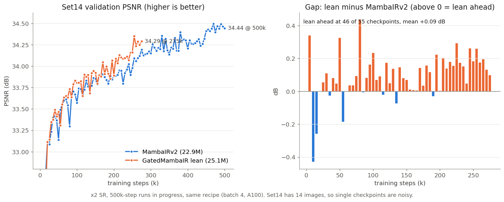

# GatedMambaIR: Idea, Method & Experiments

_Last updated: 2026-10-26. Day-by-day log: [STATUS.md](STATUS.md). All test scores: [results.csv](results.csv)._

## Overview

GatedMambaIR is an image super-resolution model that replaces MambaIRv2's Mamba selective scan with a **gated linear-attention memory with per-channel forgetting**.

- **Main ×2 result.** After the same 500k-step training, the lean model (25.1M parameters) beats MambaIRv2 (22.9M) on all five benchmarks. The gains are +0.16 dB on Urban100, +0.13 dB on Set14 and +0.01 to +0.04 dB on the rest.
- **×3 / ×4.** These fine-tunes finish on 2026-10-27, and validation points the same way.
- **What the ablations show.** The gain comes from the lean scan block, from giving its memory enough key channels, and from per-channel forgetting. The delta-rule erase, the starting idea, is not needed in the final model.

## Idea and motivation

- **Baseline.** MambaIRv2 combines window attention (local detail) with an attentive state-space block. That block assigns each pixel one of 128 learned semantic tokens and sorts pixels so similar ones sit next to each other. It then runs a one-directional Mamba scan over the sorted sequence.
- **Limitation targeted.** The Mamba scan keeps a small vector state per channel (d_state 16). Over long sequences, such as a 200×200 test tile (40,000 tokens), it can hold little about patterns seen far back.
- **Proposal.** Replace it with a matrix-valued memory `S` (value × key), as in linear attention and Gated DeltaNet. Each token writes the association of its value with its key, and later tokens read with a query.
  - A **decay gate α** controls forgetting.
  - A **write gate β** controls how strongly each token is stored.
  - Optionally, the **delta rule** first erases what `S` already predicts for the key, so repeated structure is stored once.
- **Expected gain.** Better recall of repeated patterns that are far apart in the image, which should show most on Urban100 and Manga109. The final ×2 results show exactly that pattern.

## Method

GatedMambaIR keeps the full MambaIRv2 network and changes only the state-space block: `ASSM` becomes `GSSM` ([`basicsr/archs/gatedmambair_arch.py`](../basicsr/archs/gatedmambair_arch.py)), and its selective scan becomes `GatedDeltaScan`.

**Network.** A 3×3 conv embeds the image to 174 channels, followed by six groups of six `AttentiveLayer`s and a pixel-shuffle upsampler. Each layer has two halves: shifted-window attention plus a ConvFFN, then GSSM plus a second ConvFFN.

**GSSM block** (lean version):

```
Input tokens ──► Conv 1x1 + CPE gate ──► Semantic sort ──► Gated scan ──► Norm, project, unsort
 (B, HW, 174)     (174 → 348)              ▲ index          ▲ prompt       (348 → 174)
      │                                    │                │ (16-dim, into q, α, β)
      └──────────► Router (pick 1 of 128) ─┴──► Prompt (token embedding)
```

A router picks one of 128 semantic tokens for each pixel with a hard Gumbel-softmax. Pixels are sorted by that index, so similar content becomes neighbouring tokens. The scan runs over the sorted sequence and the result is unsorted afterwards. The chosen token's 16-dim embedding is a prompt that is added to the query and to both gates.

**Scan** (`GatedDeltaScan`, lean, channel gate). It works on the 348-channel sorted sequence `x`:

- **Projections.** Query and key are `q = W_q x + P_q p` and `k = W_k x`, both L2-normalised, with **1 head × 87 key channels**.
- **Value.** `v = x` (lean: no value projection, 348 value channels).
- **Forgetting gate.** log α = −sigmoid(W_a x + P_a p), one value per key channel, bounded to [−1, 0].
- **Write gate.** β = sigmoid(W_b x + P_b p), one per head.

Recurrence, with `S` of shape value × key:

$$
S_t = S_{t-1}\,\mathrm{diag}(\alpha_t)\,\big(I - \beta_t k_t k_t^\top\big) + \beta_t v_t k_t^\top, \qquad o_t = S_t q_t
$$

- With `use_delta: false` the erase factor `(I − β k kᵀ)` is dropped. That gives gated linear attention (GLA).
- The output is `o_t + D ⊙ x_t`, with a learned skip `D` (as Mamba's D).
- GSSM's own LayerNorm and 348 → 174 projection follow.

**Chunked kernel** (`chunk_gated_delta_rule` in [`basicsr/archs/chunk.py`](../basicsr/archs/chunk.py)). The sequence is split into chunks of 128 tokens. Each chunk's output is a read from the state left by earlier chunks plus causal attention inside the chunk.

- **Decay in log space.** Decays are cumulated in log space and only exponentiated as differences ≤ 0, so nothing underflows. The bound log α ≥ −1 keeps the per-channel exponents finite, which is why the channel gate needs chunk ≤ 160.
- **Delta rule.** The within-chunk dependency is solved with the WY representation (one unit-lower-triangular solve per chunk).
- **Precision.** Everything is kept in fp32.
- **Correctness check.** [`tests/test_gated_delta_scan.py`](../tests/test_gated_delta_scan.py) checks the kernel against a token-by-token recurrence: outputs, final state, gradients, strong decay, and lengths that are not a multiple of the chunk.

**Lean vs original block.** The first version (`lean: false`) was larger:

- 5 heads × 17 keys, with a value projection.
- The prompt projected to 348 channels and added to q, k, v, α and β.
- An inner LayerNorm and output projection.
- A residual scaled by a learned scalar that starts at 0.

That came to 39.4M parameters. The lean block removes all of these and stays close to MambaIRv2's size.

**Config options** (`network_g`):

| Option | Lean ×2 | Meaning |
|---|---|---|
| `lean` | `true` | lean block (above); `false` = original 39.4M block |
| `gate` | `channel` | per-key-channel forgetting; `head` = one α per head |
| `use_delta` | `true` | delta-rule erase; `false` = GLA |
| `key_ratio`, `head_dim` | `0.25`, `87` | 87 key channels in 1 head |
| `chunk_size` | `128` | must be ≤ 160 with the channel gate |
| `use_prompt` | `true` | semantic-token prompt |
| `use_lowrank` | `false` | legacy low-rank state, unused (it still lacks the within-chunk read) |

## Experimental setup

Both models use the same recipe at each stage, so differences come from the architecture only.

| Setting | ×2 main (500k) | ×3 / ×4 fine-tune | 50k ablations (×2) |
|---|---|---|---|
| Data | DF2K, bicubic LR | same | same |
| Init | scratch | own ×2 500k weights (upsampler new) | scratch |
| Steps | 500k | 250k | 50k |
| lr / milestones | 2e-4; ×0.5 at 250k, 400k, 450k, 475k | 1e-4; ×0.5 at 125k, 200k, 225k, 237.5k | 2e-4; the 500k schedule ÷ 10 |
| HR patch / batch | 128 / 4 | 192 (×3), 256 (×4) / 2 | 128 / 2 |
| GPU | one A100 80GB | one V100 32GB | one V100 32GB |
| Loss | L1 | L1 | L1 |

- **Same schedule as the paper.** The ×3 / ×4 fine-tune is the MambaIRv2 paper's own (init from ×2, half the lr and steps).
- **Validation:** Set14 every 5k steps.
- **Test:** Set5, Set14, B100, Urban100 and Manga109. PSNR / SSIM are on the Y channel, with the border cropped by the scale factor.
- **Inference:** tiled, ~200 px LR tiles with overlap (`GatedMambaIRModel.test`).
- **Baseline:** MambaIRv2-Base was **retrained with our recipe**. The official numbers use batch 32 on 8 GPUs and are shown only as a reference.

## Results

### ×2 (500k)



| ×2, PSNR / SSIM | Params | Set5 | Set14 | B100 | Urban100 | Manga109 |
|---|---|---|---|---|---|---|
| MambaIRv2, our recipe | 22.9M | 38.46 / 0.9623 | 34.44 / 0.9250 | 32.48 / 0.9034 | 33.77 / 0.9420 | 39.90 / 0.9797 |
| **GatedMambaIR lean** | 25.1M | **38.47 / 0.9623** | **34.57 / 0.9256** | **32.51 / 0.9039** | **33.93 / 0.9430** | **39.94 / 0.9798** |
| Gain (PSNR) | | +0.01 | +0.13 | +0.03 | +0.16 | +0.04 |
| MambaIRv2 official (batch 32, 8 GPUs) | 22.9M | 38.65 / 0.9631 | 34.87 / 0.9275 | 32.62 / 0.9052 | 34.48 / 0.9468 | 40.42 / 0.9810 |

- **Largest gain on Urban100,** the set with the most long-range repeated structure.
- **Lean led for most of training:** it was ahead at 75 of 81 same-step Set14 validation checkpoints after 100k (mean +0.11 dB).
- **The late lr drops did not close the gap:** lean was ahead at 24 of 26 checkpoints after 375k.

### ×3 / ×4 (250k fine-tune)

| PSNR | Set5 | Set14 | B100 | Urban100 | Manga109 |
|---|---|---|---|---|---|
| MambaIRv2 ×3, our recipe | 34.95 | 30.86 | 29.42 | 29.60 | 35.10 |
| MambaIRv2 ×4, our recipe | 32.79 | 29.08 | 27.88 | 27.32 | 32.01 |
| GatedMambaIR lean ×3 / ×4 | pending | | | | |

The lean ×3 / ×4 fine-tunes finish on 2026-10-27, and their tests follow automatically. Lean is ahead in Set14 validation at the same step so far:

- **×3:** 42 of 46 checkpoints (mean +0.04 dB).
- **×4:** 44 of 46 checkpoints (mean +0.05 dB).

## Ablations (×2, 50k steps)

| Variant | Params | Set5 | Set14 | B100 | Urban100 | Manga109 |
|---|---|---|---|---|---|---|
| MambaIRv2 | 22.9M | 37.91 | 33.42 | 32.08 | 31.53 | 38.38 |
| Original block, delta, head gate (5×17 keys) | 39.4M | 37.93 | 33.42 | 32.08 | 31.56 | 38.36 |
| Original block, GLA (no erase) | 39.4M | 37.83 | 33.28 | 32.01 | 31.24 | 38.20 |
| Original block, delta, bigger heads (2×87 keys) | 43.8M | 37.92 | 33.43 | 32.08 | 31.54 | 38.42 |
| Original block, delta, channel gate | 41.4M | 37.74 | 33.21 | 31.95 | 31.05 | 38.06 |
| **Lean, delta, channel gate, 87 keys** (main model) | 25.1M | **37.95** | **33.46** | **32.11** | 31.70 | **38.51** |
| Lean, GLA (no erase), channel gate | 25.1M | 37.94 | 33.46 | 32.11 | **31.74** | 38.49 |
| Lean, delta, head gate | 25.1M | 37.91 | 33.41 | 32.11 | 31.64 | 38.44 |
| Lean, delta, channel gate, 30 keys (exact size) | 22.9M | 37.88 | 33.39 | 32.07 | 31.49 | 38.39 |

Each row is a single run, so differences of a few hundredths of a dB are noise.

**What they show**

1. **The lean block is the main source of the gain.** All lean variants with 87 keys beat MambaIRv2 on Urban100 (+0.11 to +0.21) and Manga109. The original block only ties MambaIRv2 despite 72% more parameters. Two likely reasons:
   - the lean scan is active from step 0 (the original started with its residual scaled to zero),
   - the lean block has no redundant projections.
2. **The memory needs enough keys.** 87 keys vs 30 keys gives +0.21 dB on Urban100. At exactly MambaIRv2's size (30 keys), the model only ties. So the honest claim is "better at +10% parameters".
3. **Per-channel forgetting helps in the lean block.** It gives +0.06 to +0.07 dB on Urban100 / Manga109 over one gate per head. In the original block it hurt (−0.51 dB on Urban100), probably by interacting with the zero-initialised residual and extra projections.
4. **The delta erase is not needed in the lean model.** GLA and delta are within ±0.04 dB. The erase mattered only in the original block (+0.32 dB on Urban100), where 5 heads × 17 keys made the memory small and crowded. With 87 keys and per-channel forgetting, there is room, so erasing adds little.

**Framing.** The paper claim is "a gated linear-attention memory with per-channel forgetting beats Mamba's scan inside MambaIRv2". The delta rule is an option studied in the ablations, not the reason it wins.

## History: the first version and the scan fix

The first GatedMambaIR (trained until Jan 2026; ×2 reached 464k) trailed the official MambaIRv2-Base by 0.25 to 1.49 dB (Urban100 33.00 vs 34.48). A code review on 2026-09-27 found that the chunked scan, not the idea, was at fault:

| Issue in the old `chunk_gated_delta_fullrank` | Effect |
|---|---|
| No within-chunk read; each token saw only earlier chunks | The first 256 tokens output zero, and every token missed its nearest semantic neighbours (they share its chunk after sorting) |
| No erase term | It was GLA, not a delta rule, so the idea was never tested |
| Decay product computed directly (0.5²⁵⁶ → 0 in fp32) | Wrong write weights |
| State kept in bf16 | Rounding error over ~160 chunks per test tile |
| `key_ratio` / `head_dim` ignored | Configs could not change the head size |

All five were fixed in `chunk_gated_delta_rule`, which is the kernel described above. The old ×3 / ×4 checkpoints were lost in the September scratch purge, and the old ×2 checkpoint was trained with the buggy scan. So every number in this document comes from **fresh runs with the fixed scan**, and the baseline was retrained with the same recipe.

## Tracking experiments

Every run of `basicsr/test.py` appends one row per test set to `docs/results.csv`. Each row holds:

- name, model, scale and dataset,
- PSNR, SSIM, image count and runtime,
- checkpoint iteration and path, and the config,
- git commit plus a dirty flag, and a tag.

Set `val.tag` in the test YAML to label a run, or `val.results_csv` to write to a different file.

```bash
python basicsr/tools/compare_results.py --list
python basicsr/tools/compare_results.py --scale 2 --metric both --baseline MambaIRv2
python basicsr/tools/compare_results.py --scale 2 --baseline MambaIRv2 --markdown   # paste into docs
python basicsr/tools/import_test_log.py results/test_X/test_*.log --tag some-label  # old logs
```

- **Keys:** experiments are keyed as `name@iter`; if a checkpoint is tested twice, the newest row wins.
- **Curves:** training curves are in `tb_logger/`. `tests/plot_500k_curves.py` and `tests/plot_ablation_curves.py` turn them into the PNGs in this folder.

## Next steps

1. **Test lean ×3 / ×4** (runs end 2026-10-27; tests are queued) and add them to the results table.
2. **Measure efficiency** against MambaIRv2: parameters, FLOPs and inference time at the same tile size, with `analysis/`.
3. **Novelty check:** prior work on linear-attention, GLA or Gated DeltaNet memories in image restoration.
4. **Optional, for a stronger paper:** a lightweight version (~0.8M params) trained with the paper's exact recipe, compared directly with published numbers.
5. **Optional ablations:** no prompt, and other chunk sizes.
